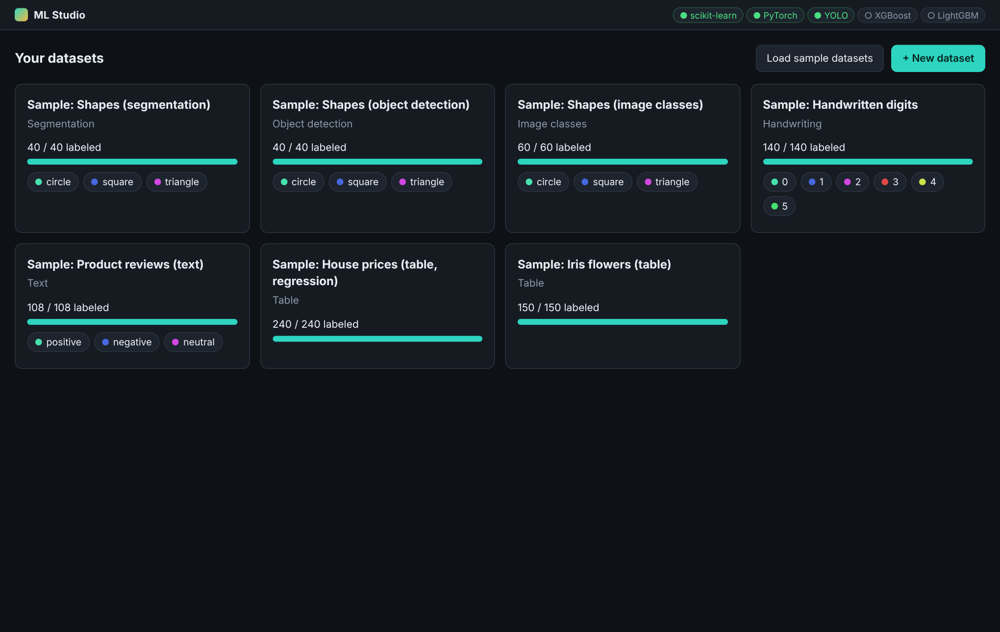
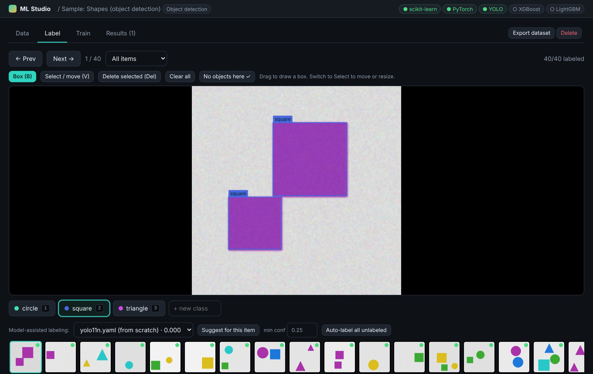
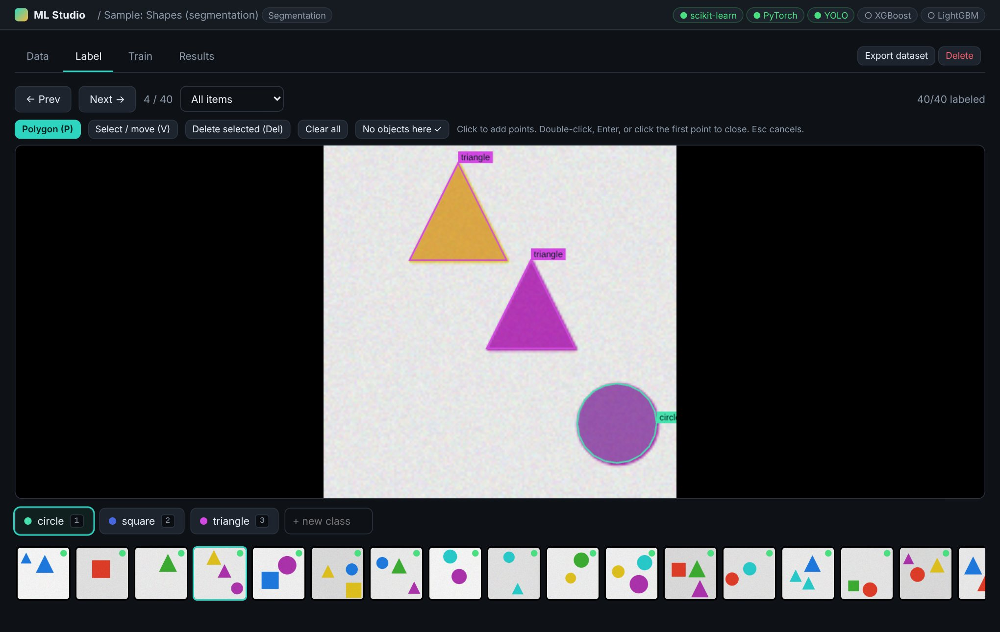
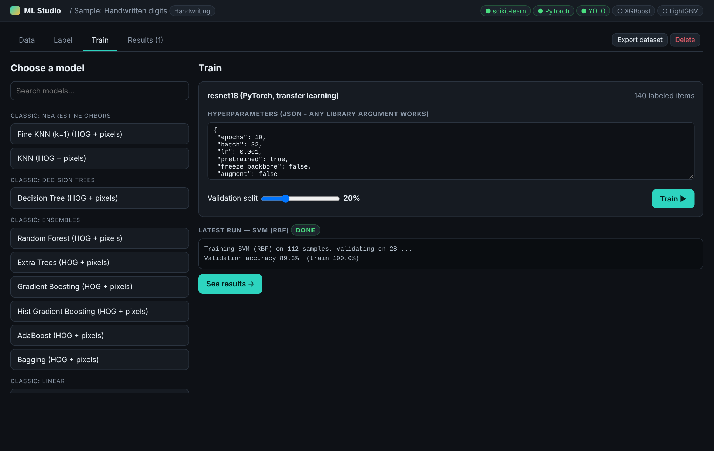
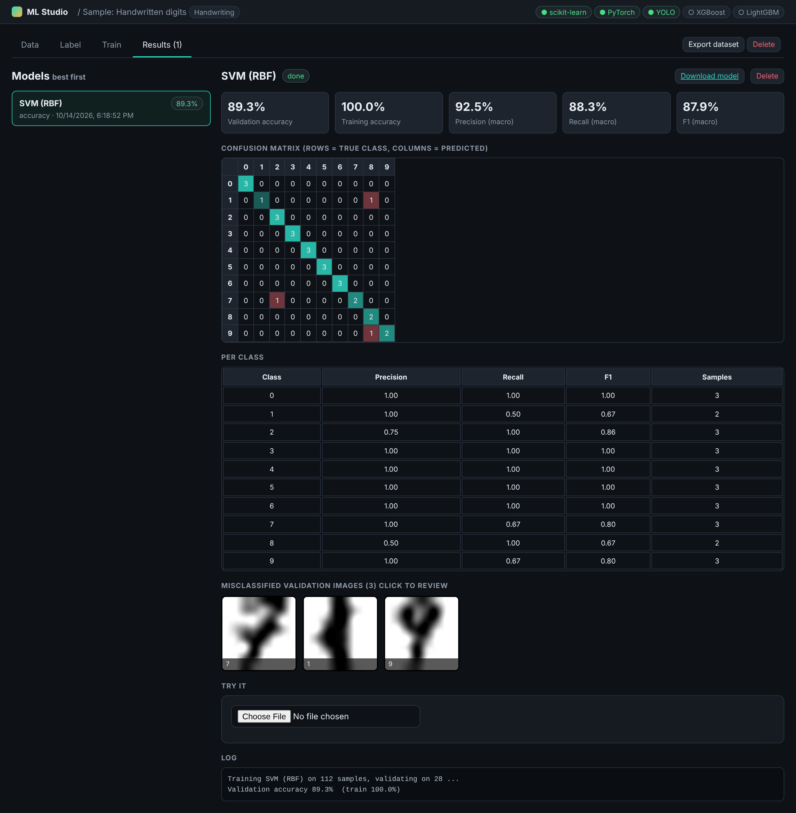

# ML Studio

A local, browser-based tool to **create datasets, label them, and train models** - no code needed.
Your data never leaves your computer. Everything is stored in the `workspace/` folder.

## Screenshots

| | |
|---|---|
|  |  |
|  |  |

## Sample datasets

Click **Load sample datasets** on the home page to get seven ready-made projects (two tables, text, handwritten digits,
and shapes for image classification, object detection and segmentation) and try training right away.
All sample data is synthetic or bundled with scikit-learn - no real photos are used:
Iris (Fisher, 1936), and the 8x8 handwritten digits set (UCI ML Repository, E. Alpaydin & C. Kaynak, CC BY 4.0).

## Start

* **Windows:** double-click `start.bat`  (first run creates a virtual environment and installs packages)
* **Mac / Linux:** `./start.sh`

Then open http://127.0.0.1:8000 (it opens automatically).

Optional libraries (the app lights up the matching models automatically, see the pills in the top-right):

| Install | Unlocks |
|---|---|
| `pip install torch torchvision` | ResNet, EfficientNet, MobileNet, ConvNeXt, DenseNet, ViT, Swin ... image classifiers (transfer learning) |
| `pip install ultralytics` | YOLO11 / YOLOv8 / YOLOv5 object detection and segmentation |
| `pip install xgboost lightgbm catboost` | gradient-boosting models for tables, text and image features |

## Dataset types

| Type | Add data | Label with | Models |
|---|---|---|---|
| Table | drop a CSV, or type rows | edit the target column in the table | 20+ scikit-learn classifiers / 13 regressors (+XGBoost/LightGBM/CatBoost) |
| Image classes | drop images, or a .zip with one folder per class | class buttons / keys 1-9 | classic ML on HOG+pixels, or any PyTorch CNN / transformer |
| Object detection | drop images | draw boxes, move/resize, keys | YOLO |
| Segmentation | drop images | draw polygons | YOLO-seg |
| Text | type, paste, .txt (one per line), or .csv (`text,label`) | class buttons / keys | TF-IDF + any classifier |
| Handwriting | drop photos/scans of notes or characters | type what it says | classic ML or PyTorch CNN (each distinct text = one class: letters, digits, words) |

## Workflow

1. **New dataset** - choose a type, optionally list classes.
2. **Data** tab - add data, manage classes, pick the target column (tables).
3. **Label** tab - label fast with the keyboard. Once you have a model, use *Suggest for this item* or
   *Auto-label all unlabeled* and just correct its mistakes (model-assisted labeling).
4. **Train** tab - pick a model, edit hyperparameters (plain JSON; any argument of the underlying library works),
   choose the validation split, press Train. Live logs and curves, with a Stop button.
5. **Results** tab - models are ranked best-first. See accuracy / R2 / mAP, confusion matrix, per-class precision/recall,
   misclassified images (click to fix their labels), training curves, then **Try it** on new inputs.
   Download the model file (`.joblib` for scikit-learn, `.pt` for PyTorch/YOLO) to use it in your own code.

**Export dataset** (top right) gives a zip: CSV for tables/text, class folders for image classes,
YOLO-format `images/` + `labels/` + `classes.txt` for detection/segmentation.

## Tips

* GPU: PyTorch and YOLO use CUDA (NVIDIA) or Apple MPS automatically if available.
* Pretrained weights (ResNet, YOLO ...) are downloaded on first use, so that needs internet once.
  If the download fails for a PyTorch model, the app trains from scratch instead and says so in the log.
* Aim for at least ~30 labeled examples per class. Compare training accuracy with validation
  accuracy in Results - a big gap means overfitting, so add more data.
* Models labeled "(from scratch)" start with random weights.

## Adding your own algorithm

All trainers live in `app/trainers.py`. Add a function that takes the labeled items, trains,
saves a model into the run folder, and returns a metrics dict; register it in `catalog()` and `start_training()`.

## License

ML Studio is released under the **GNU AGPL-3.0** (see `LICENSE`).
It optionally uses [Ultralytics YOLO](https://ultralytics.com/license), which is also AGPL-3.0 (or commercial license).
Other dependencies (scikit-learn, PyTorch, FastAPI, OpenCV, ...) have their own permissive licenses.

## Contributing

Contributions are welcome - see [CONTRIBUTING.md](CONTRIBUTING.md).
